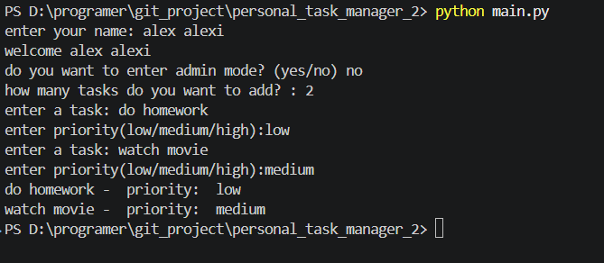
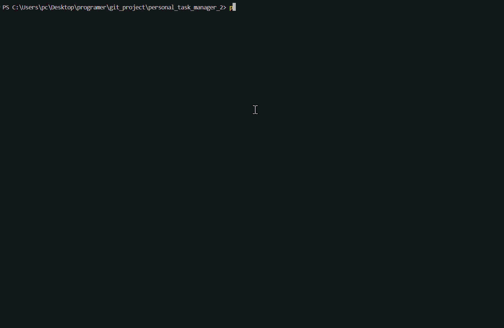

# Personal Task Manager


A simple task manager built with python for learning


# Features
- add multiple tasks
- save tasks
- load saved tasks
- admin mode

# Requirments
- Python
- pyhton-dotenv

## Project structure

``` text
personal_task_manager:.
│   .env.example
│   .gitignore
│   main.py
│   README.md
│   requirements.txt
│   tasks.py
│   
│       
├───gifs
│       gif.gif
│       
├───screenshot
│       screenshot.png
```

# Installation
Install the required packages:

```bash
python -m pip install -r requirments.txt
```
## Envoirment setup
create a `.env` file in the project folder

Use `.env.example` as a template

```env
admin_pass=your_password_here
```
replace `your_password_here` with your own admin password

## run the program
run the main file :
```bash
python main.py
```

## Screenshot


## Demo
